# Yao Agents 标志设计规范

> v1.9 ｜ 2026-10-19 ｜ 设计定稿候选
> 19 页 PDF：[Yao-Agents-品牌规范-v1.9.pdf](Yao-Agents-品牌规范-v1.9.pdf)

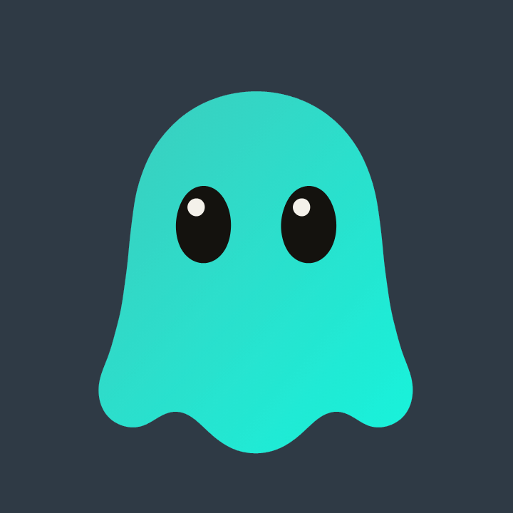

---

## 0. 摘要

Yao Agents 的符号是一只 **Ghost**：圆顶、轻微内收的腰、三个软瓣下摆，两颗竖椭圆眼睛，一个小高光，没有嘴。

- **主标**：瘦长比例 **442 × 509**（W/H **0.868**），用于 lockup、网页、动效、周边。
- **图标**：同一个形态，放入 1024 tile，Ghost 高 **780（76%）**；不换比例，只改容器与缩放。
- **色彩**：标志 body 用固定渐变 `#36D2C2 → #19F0D9`；眼睛 `#14120E`；高光 `#F4F1EA`；UI 主色 `#2A7B7B` 只做界面。
- **字标**：Inter，`Yao` 700 + `Agents` 500，tracking −3.5%（临时）。
- **动效**：24 个谐波（49 个圆）把轮廓画出来；14s 品牌片。
- **一句话**：A ghost, drawn by circles.

---

## 1. 命题

Yao Agents 把 Engine、Tai Link 和 Agents 收进一个 App：一个入口，管理所有 Agent 与 Workspace；桌面、手机、浏览器、API 都能到；可以自托管。

旧标的问题不是“丑”，是它更像一个功能图标，而不是一个角色。新符号要同时做到四件事：

1. 像一个角色，而不是一个按钮；
2. 16px 还能读；
3. 单色还能成立；
4. 动起来像“被画出来”。

三个关键词：

| | | |
|---|---|---|
| **Friendly / 友好** | 不吓人，也不幼稚 | 像安静的同事，不是吉祥物玩具 |
| **Light / 轻** | 没有机械结构，没有多余零件 | 一个形状、两个点、一条下摆 |
| **Present / 在场** | 两只眼睛看着你 | Agent 的在场感来自注视，不来自天线 |

**为什么是 Ghost：** Agent 平时不可见，需要时出现；Ghost 就是“出现”的形状。它没有手、没有嘴、没有工具，不抢产品功能的戏；它可以出现在任何设备上，像同一个角色跟着你。它也承接“Ghost in the machine”的隐喻，但保持可爱，不做恐怖。

**否掉的：** 太极双面（依赖两色、16px 糊）、链环（太直白、像眼镜）、机器人头（太通用）。

> Agents are invisible until they’re needed. The mark should feel like an appearance, not a machine.

---

## 2. 标志

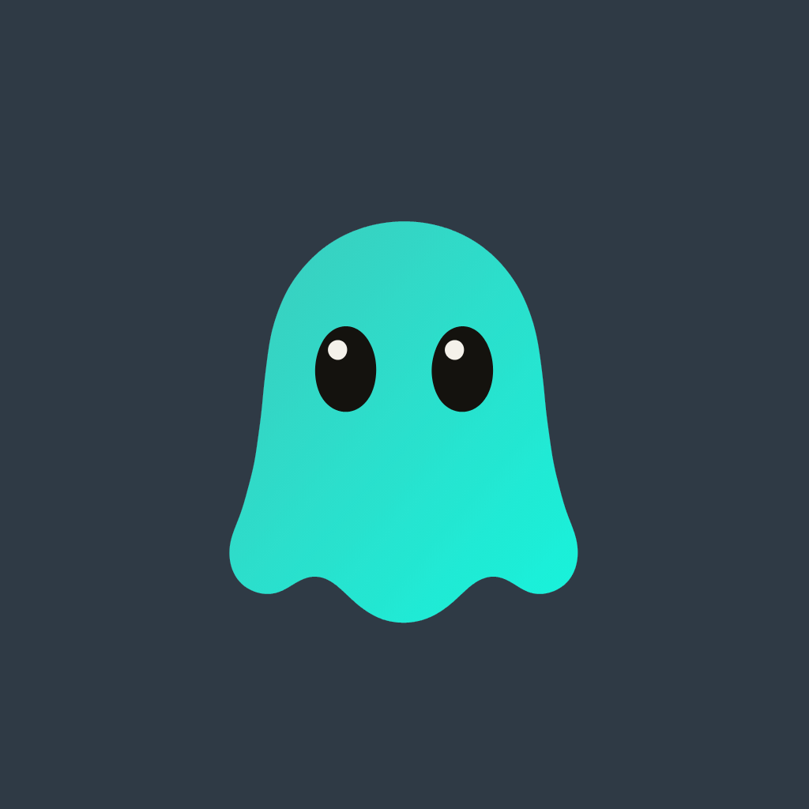

| 部位 | 规则 |
|---|---|
| **Body** | 一条连续的钟形曲线；不是圆，也不是圆角矩形。窄是故意的——它是角色，不是 App 容器。 |
| **Eyes** | 两颗竖椭圆，无瞳孔；视线由高光决定，所以总是略微向上、向左看。 |
| **Highlight** | 唯一的高光；小、偏左上；彩色版 64px 以上必须保留，16–32px 可去掉。 |
| **Hem** | 三个软瓣；给角色一个“站得住”的底，也让 16px 仍像 Ghost。 |
| **Mouth** | 没有。安静、专注，不变成表情包；情绪交给眼睛。 |

**Dark：** Cream body on `#2F3A45`、eyes `#14120E`、highlight `#F4F1EA`；它和 Mono 是两件事。

性格：好奇、安静、稍微有点淘气。不是婴儿玩具，也不是恐怖片。

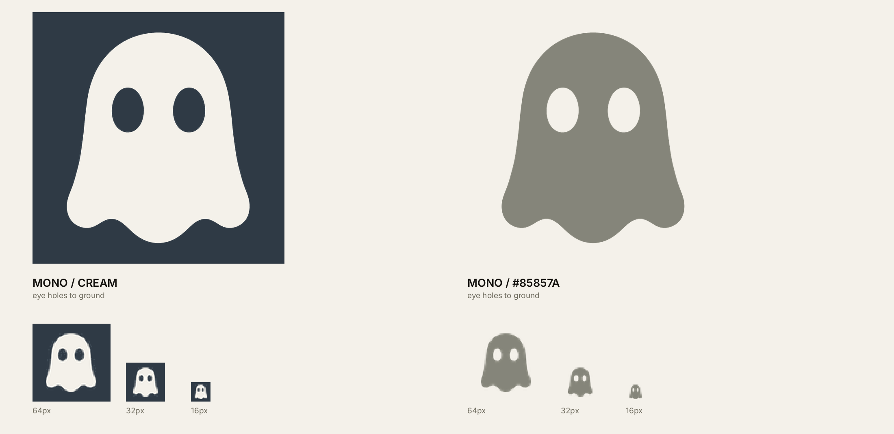

---

## 3. 构造

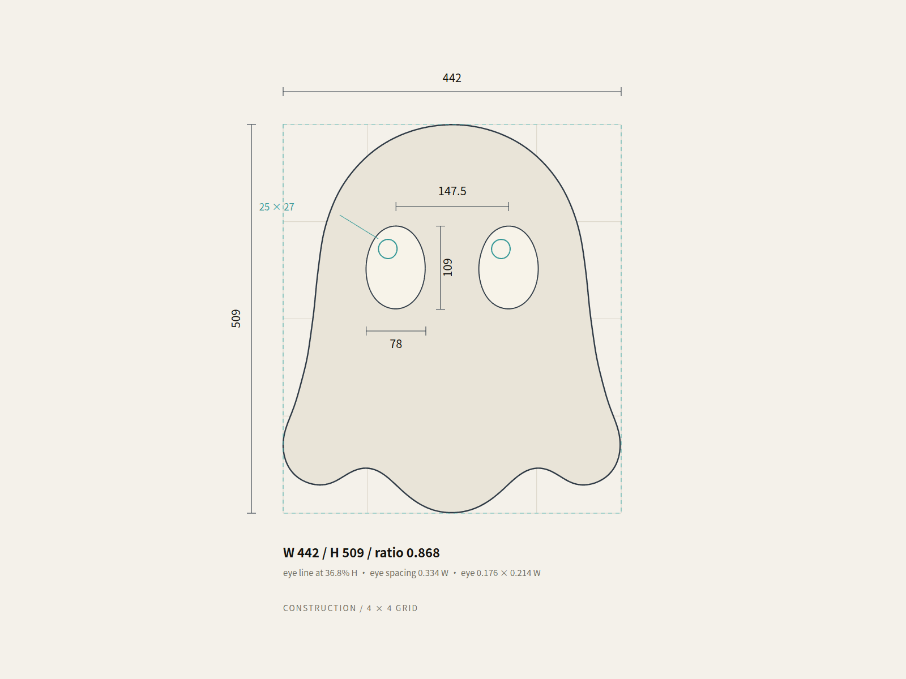

| 尺寸 | 值 | 比例 |
|---|---:|---:|
| Body width W | 442 | 1.000 W |
| Body height H | 509 | 1.152 W |
| W / H | **0.868** | — |
| Eye | 78 × 109 | 0.176 W × 0.214 W |
| Eye spacing | 147.5 | 0.334 W |
| Eye line | 36.8% H | from top |
| Highlight | 25 × 27 | offset 10.5 left / 24 up |

所有尺寸以 H = 509 为基准，等比缩放。轮廓是一条连续曲线；没有直线段，没有尖角。下摆三瓣，外角收圆，瓣与瓣之间是软谷。

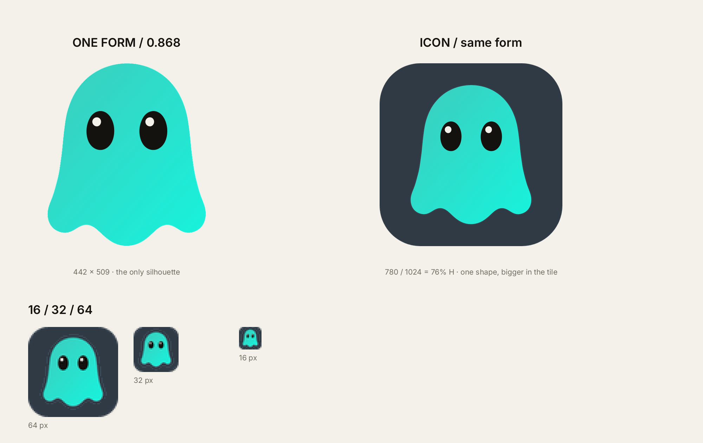

---

## 4. 比例系统

只有一条轮廓：**442 × 509，W/H 0.868**。App 图标也不换形——把同一个 Ghost 放大到 1024 tile 的 **76% 高**，左右留 173。形不变，容器变。

| Dimension | Value | Note |
|---|---:|---|
| Body W × H | 442 × 509 | the only silhouette |
| W / H | **0.868** | never stretched |
| Icon scale | 780 / 1024 | 76% H inside the tile |
| 16px body width | **10.6px** | same form, larger in tile |
| 16px eye width | **1.9px** | same eyes, not redrawn |

**规则：**

1. 所有尺寸都用同一条路径；图标只改容器和缩放，不改比例。
2. 不要为了“更像图标”把身体拉宽；16px 的解法是放大，不是改形。

---

## 5. 色彩

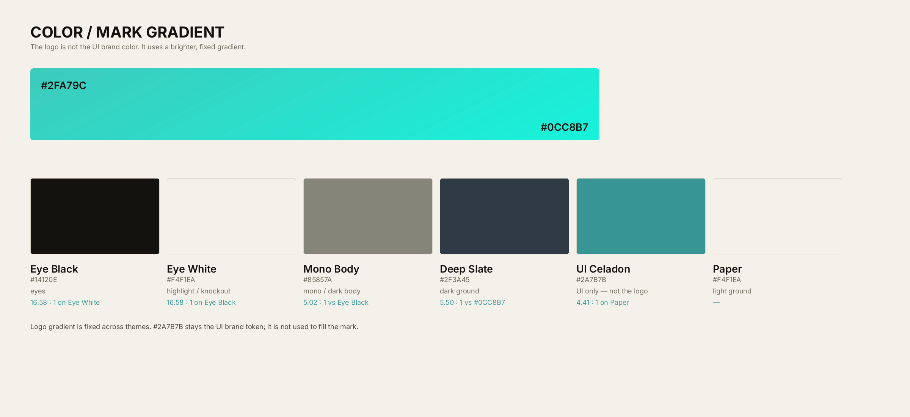

| Token | Hex | Use | Note |
|---|---|---|---|
| `--brand-mark-from` | `#36D2C2` | logo gradient start | bright celadon |
| `--brand-mark-to` | `#19F0D9` | logo gradient end | brighter cyan |
| `--text-primary` | `#14120E` | eyes | not `#000` |
| `--logo-mono-body` | `#85857A` | mono body | not `#000` |
| `--brand-eye` | `#F4F1EA` | highlights / eye white | warm white |
| `--logo-ground` | `#2F3A45` | dark ground | not `#000` |
| `--brand` | `#2A7B7B` | UI brand token | never fills the mark |

**LOGO ≠ UI color。** 标志的 body 用固定的 `#36D2C2 → #19F0D9` 渐变，不跟主题切换；`#2A7B7B` 只做界面主色。渐变起点比主色亮一档，终点再亮半档——这是刻意的。

**Dark：** body = **Cream `#F4F1EA`** on `#2F3A45`（不是黑）；eyes = `#14120E`；highlight = `#F4F1EA`。

**Mono：** body = `#85857A`，眼睛直接挖到背景，**没有 highlight**。

**禁止：** 用 `#2A7B7B` 平涂 logo、纯黑 `#000` 做 body/eyes、加第三种品牌色、把渐变改成投影/发光。

---

## 6. 字标与组合

字标用 Inter：**Yao 700 + Agents 500**，tracking −3.5%。一个字重差，读成“一个平台 + 一群代理”。这是临时字标；最终定制字母时保持这个重量关系。

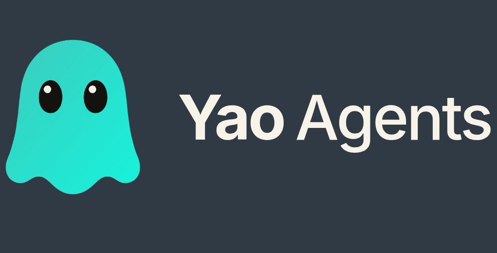

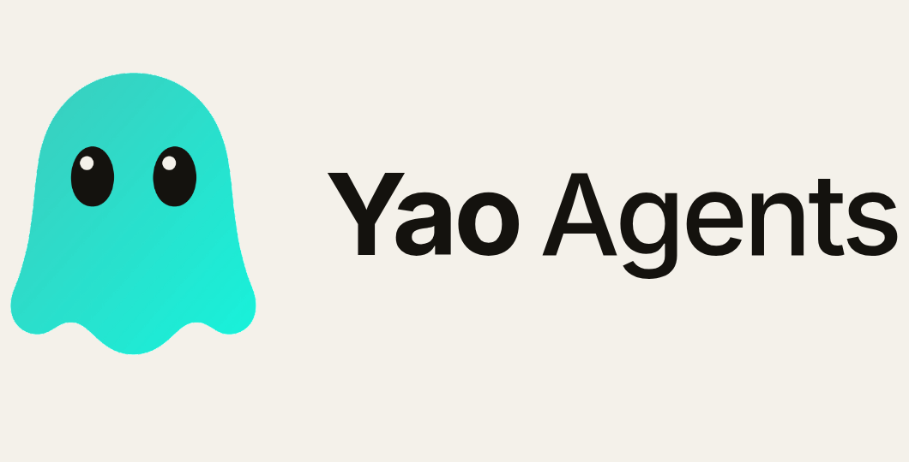

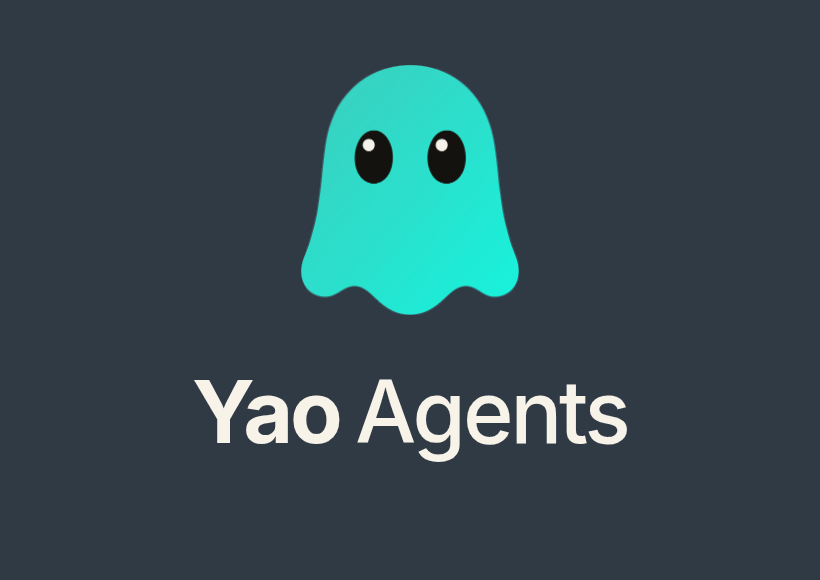

- **组合比例：** ghost H = 1.0；字标 cap height = 0.29 H；水平间距 = 0.28 W（ghost 宽）。堆叠间距 = 0.22 H。
- **Clear space：** X = eye height（0.214 H）；四边至少 1X，深底/复杂背景 1.5X。
- **最小尺寸：** 水平 lockup 120px 宽；堆叠 80px 宽；单独符号 24px 高；App 图标 16px。
- **字重：** 只写“Yao Agents”，不缩写为“YA”，不全大写。

---

## 7. 图标系统

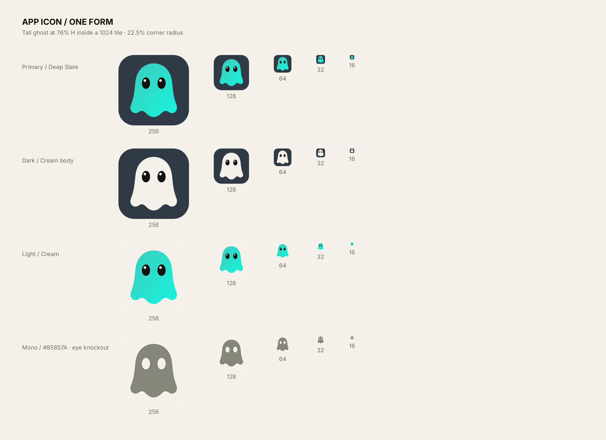

- 1024 母版，22.5% 圆角，Ghost 高 780（76%），左右留 173；没有方形 cut。
- 尺寸：1024 / 512 / 256 / 128 / 64 / 32 / 16。
- 彩色版 64px 以上必须带眼睛高光；16 / 32px 可去掉；Mono 只保留剪影 + 挖空眼，无高光。
- 四种版本：Primary 渐变；Dark Cream body；Light 渐变；Mono `#85857A` silhouette + eye knockout。
- 不要给图标加文字、边框、阴影或第二层圆角。

**16px 检查：** body 10.6px 宽、眼睛 1.9px、下摆仍能看出三个软瓣。若低于这个，改用单色版，不要加粗眼睛。

---

## 8. 单色与背景

Mono 只做剪影 + 挖空眼：body `#85857A`（浅底）或 Cream（深底），眼睛直接挖到当前底色；没有高光、没有第二个颜色。像 QQ 工具栏图标，只有轮廓和两个眼洞。

**Dark 不是 Mono：** Dark 仍然是 Cream body + 黑眼 `#14120E` + 白高光 `#F4F1EA`；不要把它并进 Mono。

- **Mono 规则：** 一个 fill + 两个 eye knockout；16px 只读轮廓，眼洞消失时保留下摆，不要加粗眼睛。
- **背景：** 浅底用 `#85857A`；深底用 Cream；中间调背景先测对比度，低于 4.5:1 就换方向。
- **Print：** 一色 + 纸白：body `#85857A` 或 Cream；眼睛是 knockout，不是印白点；min 8mm 高。
- **Screen：** 优先 SVG；16–32px 用同形图标；不要用位图缩放到 16px。
- **Merch：** 刺绣 min 12mm；单色优先；眼睛是镂空，不要用绣线补高光。

---

## 9. 动效

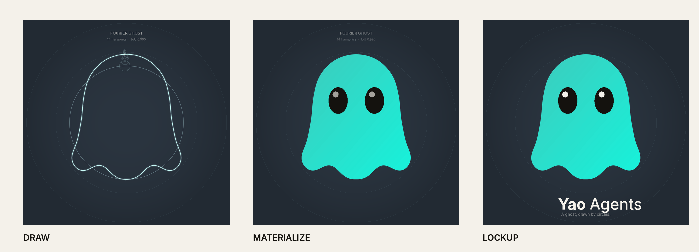

标志的轮廓可以由 **24 个谐波（49 个圆）** 画出来。动效原则：先画轮廓，再填色，最后睁眼；圆圈是构造，不是装饰。一个画面只做一次揭示。

| N | Body IoU | Max error | Use |
|---:|---:|---:|---|
| 8 | 0.9840 | 6.1px | 16px icon |
| 12 | 0.9947 | 2.7px | loading |
| 16 | 0.9976 | 1.5px | brand film |
| 24 | 0.9987 | 0.65px | master |
| 48 | 0.9989 | 0.54px | print |

**视频：** 14s / 1080×1080 / 30fps / H.264
[ghost-fourier.mp4](ghost/ghost-fourier.mp4)

节奏：draw 7.0s → fill 0.55s → eyes 0.42s → hold / lockup 2.0s。加载动画用 N=8–12；reduce motion 时直接给最终帧，不播放圆圈。

---

## 10. 应用

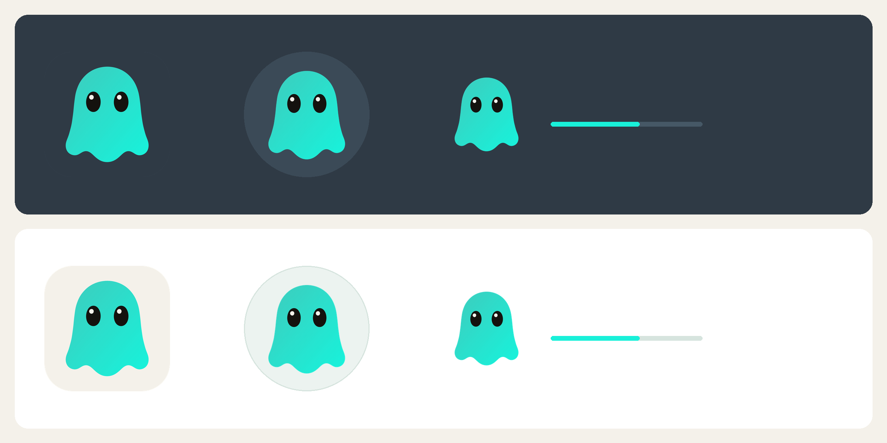

| Surface | Master | Safe area | Format |
|---|---:|---:|---|
| App icon | 1024 × 1024 | 192px | SVG + PNG |
| Avatar | 512 × 512 | 14% | PNG / WebP |
| Loading | 1080 × 1080 | 20% | MP4 / Lottie |
| Light 版本 | 同 master | 同 safe area | 只换容器底色 |
| Favicon | 32 × 32 | 2px | ICO / SVG |

- **App icon：** 同一形态，76% H；Dark 用 Deep Slate 底，Light 用 Cream 底；不要文字；彩色版 64+ 必带高光，16px 可去。
- **Avatar：** 瘦长主标；圆形裁切时保留下摆，不要裁到眼睛。Dark 头像与 App icon 同用 Slate 底，不另起深绿。
- **Loading：** Ghost + 一条 Celadon 进度线；Dark / Light 都直接落在容器底色上，不加卡片。

---

## 11. 误用

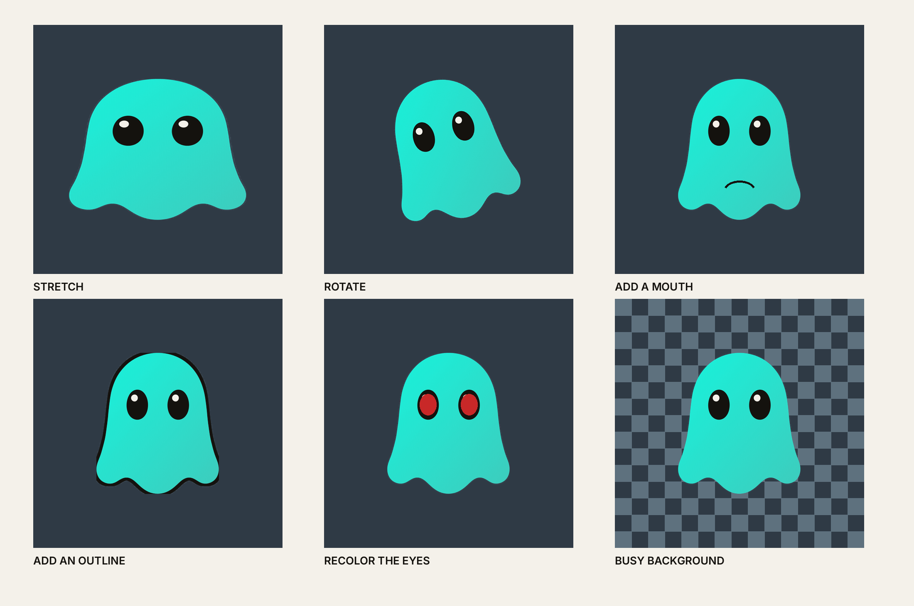

不要拉伸、旋转、加嘴、加描边、改眼睛颜色、放在复杂背景上。若一个改动需要解释，它就是错的。

---

## 12. 资产与决策

**资产：**

| 文件 | 内容 |
|---|---|
| `brand/ghost-gradient-*.png` | 主标渐变（dark / light / transparent） |
| `brand/ghost-mono-sil-*.png` | Mono 剪影（Cream / #85857A） |
| `brand/icon-tall-*.png` | 图标（同一形；slate / cream / mono） |
| `brand/construction.svg` | 构造图 |
| `brand/lockup-*.png` | 水平 / 堆叠组合 |
| `ghost/ghost-fourier.mp4` | 14s 品牌片 |
| `17 / 18 号文档` | V4 与高瘦版的傅里叶分析 |

**已定：**

- Ghost 只有一种形态：主标与图标都用同一条路径；图标只改容器与缩放；
- Mark gradient #36D2C2→#19F0D9；Eye Black #14120E；Eye White #F4F1EA；去掉 Yao Blue；
- Inter 临时字标；24 谐波动效；彩色版 64+ 必带高光，16px 可去。

**未定：**

- 定制字标；
- 商标图形检索；
- 16px 实际印刷打样；
- 品牌片配乐；
- 16:9 / 4K 版本；
- 场景图定稿后转矢量合成版；
- 桌面宠物 16:10 壁纸版与 3s 循环动效。

**决策记录：**

| 日期 | 决定 | 状态 |
|---|---|---|
| 2026.10.18 | V4（方形）vs 高瘦 Ghost → 高瘦 Ghost 为主标 | Decided |
| 2026.10.18 | 图标用同一形态、76% H；不做方形 cut | Decided |
| 2026.10.18 | Primary gradient #2FA79C→#0CC8B7；Dark Cream body + #14120E eyes + #F4F1EA highlight | Decided |
| 2026.10.18 | Mono #85857A silhouette + eye knockout; no highlight | Decided |
| 2026.10.18 | 19 张场景图（桌宠/海报/角度/物料）入规范 11–13 节 | Review |
| 2026.10.18 | 桌面宠物改用真实 macOS 截图；01/03/06 入规范第 14 节 | Decided |
| 2026.10.19 | 标志渐变 +15%：#33C5B6 → #18E2CD | Superseded |
| 2026.10.19 | 标志渐变 +22%：#36D2C2 → #19F0D9 | Decided |
| 2026.10.19 | 傅里叶标准定为 N=24（49 个圆）；N=48 只用于印刷 | Decided |
| 2026.10.19 | 应用补 Light 组；头像与 App icon 统一 Slate 底 | Decided |
| 2026.10.18 | Inter 700/500 作为临时字标 | Provisional |
| — | 定制字母、商标检索、16px 打样 | Open |

---

## 应用场景（v1.4 新增，待审核）

19 张场景效果图，已作为 **11–13 节（3 页）** 进规范：桌宠、海报、角度与物料。完整清单与生成说明见 [`20-场景效果图-2026-10-18.md`](20-场景效果图-2026-10-18.md)。

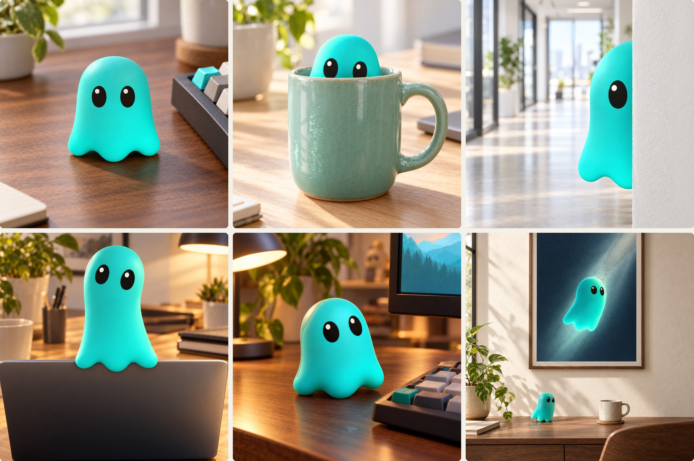

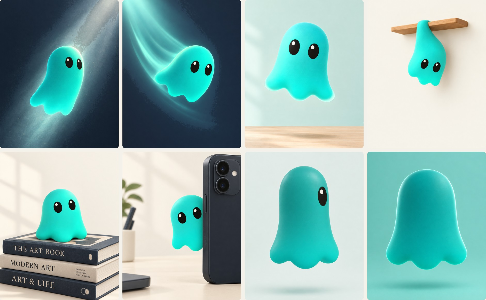

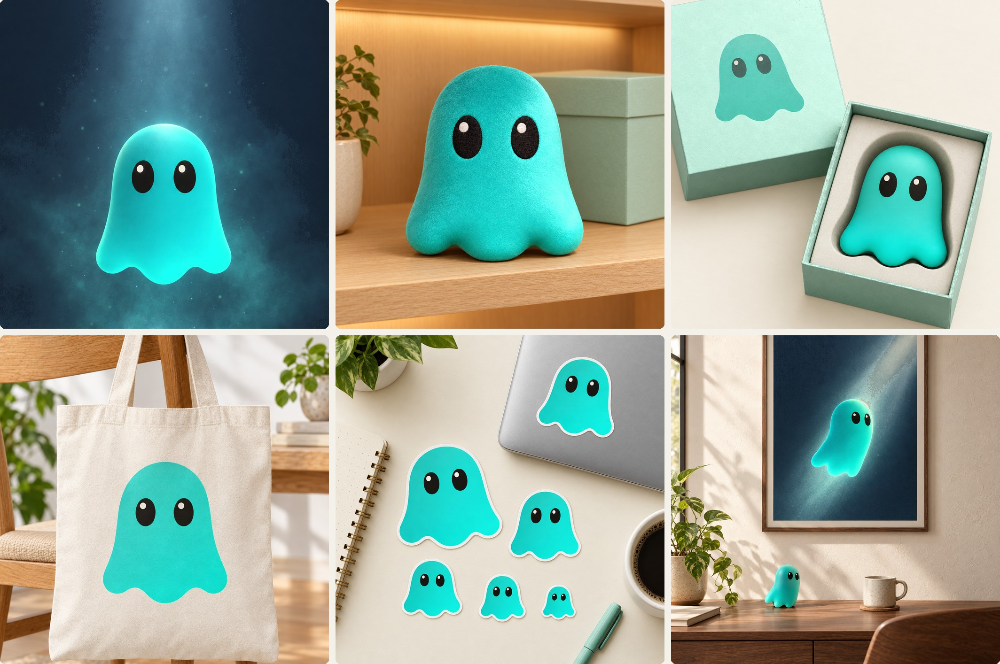

- **桌宠**：3/4 正面（主推）、躲杯子、墙后探头、屏幕后拉长
- **海报**：光柱悬浮、俯冲、跳跃、挂杆、坐书、手机挂件（默认不放字标，留负空间叠加）
- **角度**：正侧一只眼、背面不画眼；下摆三瓣在侧视/俯视下都不能变四条腿
- **物料**：毛绒、包装、帆布袋、贴纸、挂画、深空主视觉；先矢量稿再做工艺

> 场景图用 gpt-image 2.5 以矢量主标为参考生成，用于方向审核；正式物料需用矢量合成，避免生成图的比例漂移（1:1–2:1）与高光偏大。

---

## 桌面宠物（v1.5 新增，已选定）

真实 macOS 截图 + 独立 3D 宠物 sprite 合成，不是 mock；选定 **01 右下角站立 / 03 坐 Dock / 06 气泡** 三张，作为规范第 14 节。

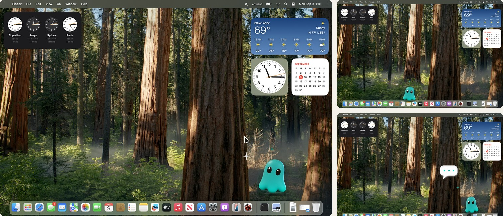

| # | 姿态 | 高度 | 基线 |
|---:|---|---:|---|
| 01 | 右下角站立，抬头看光标 | 172 px | Dock 上方 |
| 03 | 坐在 Dock 上 | 150 px | Dock 上沿 |
| 06 | 三点气泡 + 站立 | 164 px | 屏幕底边 |

动效：Idle 2.4s（1.5% 浮动）/ Bounce 0.45s（压扁 0.94 → 拉长 1.08）/ Peek 0.6s（滑入 40%）。姿态只改旋转与压扁，眼睛、三瓣下摆、无嘴无手脚不变。

---

## 附录：傅里叶

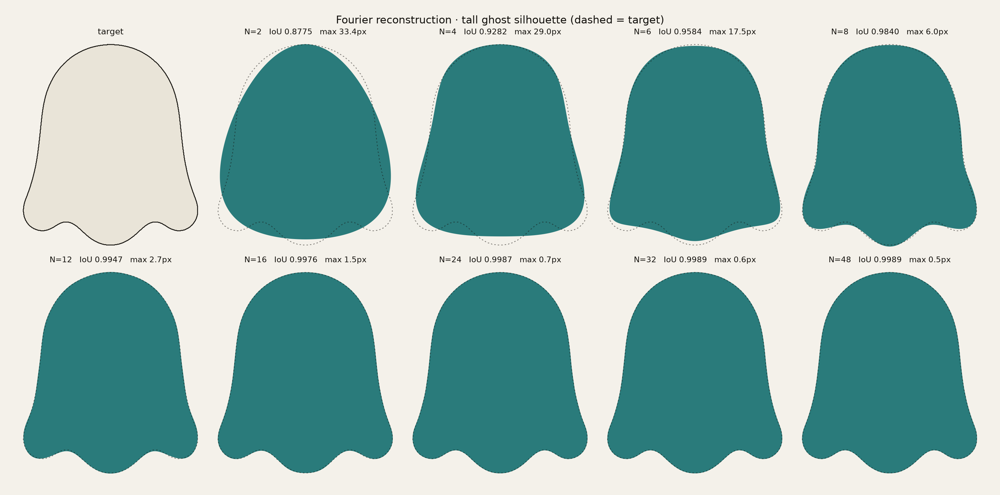

**方法：** threshold 160 → 最大轮廓 → 4096 点弧长重采样 → FFT → 保留 2N+1 个系数 → inverse FFT。

**为什么选高瘦版：** 它是一条连续的钟形曲线，N=16 就到 0.9976；V4 的近方形肩线和更深的下摆需要 N=32–48 才到同样精度。图标用同形放大到 76% H，16px body 10.6px；不另做方形 cut。

> 傅里叶是无限级数；有限 N 在三个下摆软瓣处一定留下圆角。N=16 在 1024px 下最大偏差 1.5px；N=24 为 0.65px，已经亚像素；N=48 为 0.54px，边际收益已经很小。
