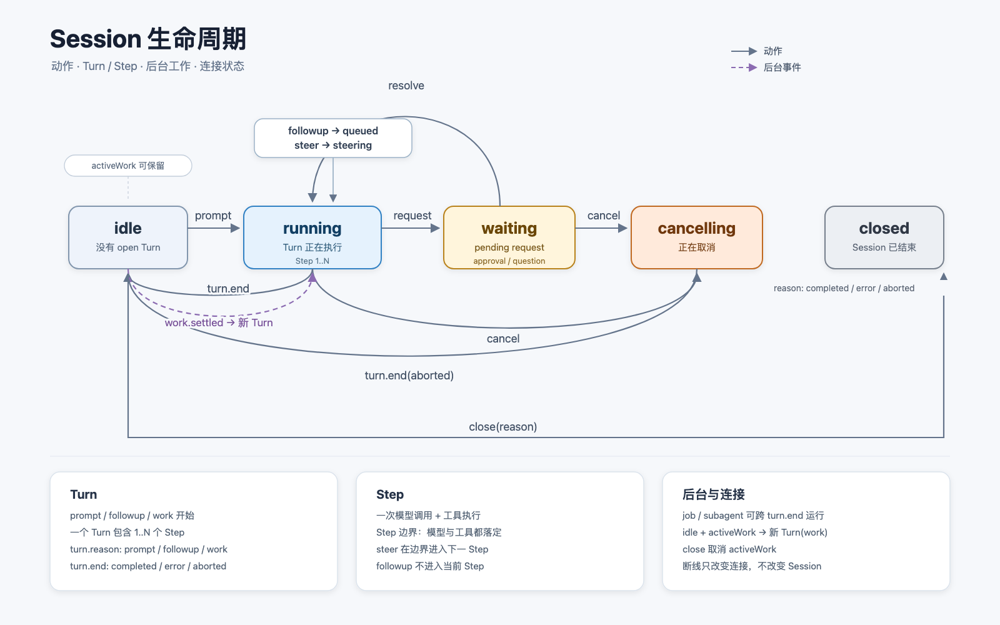
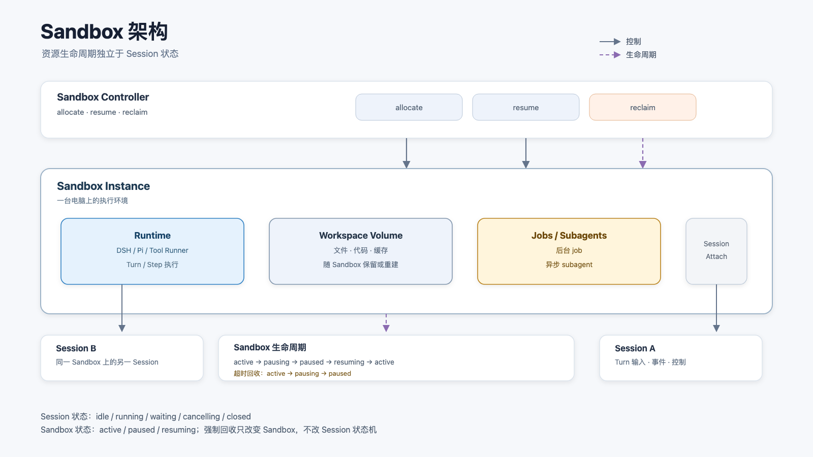

# 实时联络架构

> 状态：架构方案 · 2026-10-22
> 范围：文本会话、语音与视频通话、Agent 主动联络、Runner 接口与客户端接口。

## 1. 目标

一个 Session 同时支持：

- 文本对话与运行中控制；
- 语音通话与视频通话；
- Agent 主动发起文本、语音或视频联络；
- 多端在线、离线推送与断线恢复。

核心约束：

- 通话中的取消、审批与音频不能被文本或视频阻塞；
- 运行中可以排队、引导、打断和停止；
- 视频不能拖累音频；
- 客户端只负责展示与提交意图，业务状态由后端持有；
- 新增语音或视频 Provider 不增加前端分支。

## 2. 组件

| 组件 | 责任 |
| --- | --- |
| SessionRunner | 执行 Session，处理文本输入、引导、打断、工具与审批 |
| SessionTransport | Session 的实时通信层，处理媒体、DataChannel、Provider 与连接 |
| SessionOutreach | 主动联络，处理邀请、振铃、过期、拒绝与设备仲裁 |
| EventHub | 全局事件、事件游标、断线重连与推送触发 |
| SessionClient | 前端实时通信客户端 |
| OutreachClient | 前端主动联络客户端 |
| CallInvite | 语音或视频呼叫邀请 |
| CallSession | 接受后的语音或视频会话 |
| CallProvider | OpenAI Realtime、本地语音、SIP 等媒体 Provider |

边界：

- SessionTransport 不是通用 API Gateway，不处理 Session 增删改查、Inbox 与 Outreach 状态。
- SessionRunner 不处理媒体连接。
- SessionOutreach 不建立媒体，只决定是否发起联络、向谁发起、哪台设备接受。
- Call 只表示语音或视频通话，不表示整个 Session 通信层。

## 3. 总体架构

```text
┌──────────────────────────────────────────────────────────────┐
│ Client                                                       │
│  SessionClient · OutreachClient · EventStream · Inbox · CallUI│
└───────────────┬──────────────────────────────┬───────────────┘
                │ WebRTC media                 │ /v1/events + Push
                │ DataChannel control/text     │
┌───────────────▼──────────────────────────────▼───────────────┐
│ Backend                                                      │
│  SessionTransport    SessionOutreach        EventHub         │
│  ├ OpenAI adapter    ├ invite / ring        ├ outreach.*     │
│  ├ Local adapter     ├ expiry / decline     ├ call.*         │
│  └ SIP adapter       └ device arbitration   └ mail.*         │
│                                                              │
│  SessionRunner                                               │
│  ├ prompt / followup / steer / cancel                       │
│  └ tools / approvals / transcript                            │
│                                                              │
│  Session Store · Outreach Store · Device / Push Registry     │
└──────────────────────────────────────────────────────────────┘
```

## 4. 传输

### 4.1 流量类型

| 流量 | 内容 | 传输 | 规则 |
| --- | --- | --- | --- |
| control | cancel、resolve、ping | DataChannel | 高优先级、可靠、小帧 |
| text | 消息、工具、状态、转写 | DataChannel | 可靠、可恢复、可合并 |
| audio | PCM 上下行 | WebRTC media | 低延迟、可丢帧、不重传 |
| video | 摄像头、屏幕共享、关键帧 | WebRTC media | 可丢帧、独立于音频 |

四类流量按场景创建，不是四条固定连接。

纯文本没有 DataChannel，`control` 与 `text` 走 Session WebSocket；通话建立后优先走 DataChannel。

### 4.2 连接

| 场景 | 连接 |
| --- | --- |
| 纯文本 | EventHub WebSocket + Session WebSocket，无 PeerConnection |
| 语音通话 | PeerConnection：audio track + control DataChannel + text DataChannel |
| 视频通话 | 语音连接增加 video track |
| 主动联络 | EventHub 与推送负责叫醒，接受后建立语音或视频连接 |

### 4.3 并发与恢复

- control 独立队列，不等待 text、audio、video；
- 下行拥塞时先丢 video，再丢旧 audio，不丢 control；
- 每个流量独立编号，客户端不要求跨流量顺序；
- Session 使用 `sessionEpoch`，重连带 `lastSeq`；
- 上行队列满返回 `inputFull`，不阻塞读循环；
- 客户端断线不取消 Agent 工作，除非用户显式停止；
- 已产生的外部副作用不自动回滚。

## 5. Stream



> 图 1：Session、Turn、Step、后台工作与连接状态的总览。连接断开不改变 Session 状态。

### 5.1 状态

| 状态 | 含义 | 允许的动作 |
| --- | --- | --- |
| `idle` | 没有进行中的 Turn，可能仍有后台工作 | `prompt`、`close` |
| `running` | Turn 正在执行 | `followup`、`steer`、`cancel`、`close` |
| `waiting` | 有 pending request | `followup`、`resolve`、`cancel`、`close` |
| `cancelling` | 正在取消 | `cancel`（no-op）、`close` |
| `closed` | Session 已结束 | 无 |

`waiting` 只有一个状态，`pending.kind` 区分 `approval` 与 `question`。两者允许的动作相同，区别在 `resolve` 的载荷与后续效果，不在状态名。

`idle` 只表示没有进行中的 Turn，不表示没有后台工作。后台 job 与 subagent 可以在 `idle` 时继续运行，完成后通过新 Turn 回到 Session。

`closed` 只是生命周期状态，结果在 `closed.reason`：

```text
completed   正常完成
error       失败
aborted     被取消
```

`closed` 表示 Session 结束，不表示 WebSocket 断开。连接状态与 Session 状态是两条独立的轴。

### 5.2 动作

| 动作 | 语义 | 结果 |
| --- | --- | --- |
| `prompt` | 开始新的 Turn | `idle` 进入 `running` |
| `followup` | 在当前 Turn 之后追加消息 | 当前 Turn 继续，消息进入下一 Turn |
| `steer` | 在最近 Step 边界插入消息 | 当前 Turn 继续，下一次模型调用看到消息 |
| `cancel` | 终止当前 Turn | 保留部分输出，进入 `cancelling`，最终 `idle` |
| `resolve` | 解决一个 pending request | 从 `waiting` 回到 `running` 或结束 |
| `close` | 结束 Session | 终止活动，进入 `closed` |

`prompt`、`followup`、`steer` 都只进入 Session 的 Turn 输入。

动作统一封装：

```text
Action {
  actionId
  sessionId
  type: 'prompt' | 'followup' | 'steer' | 'cancel' | 'resolve' | 'close'
  expectedEpoch
  payload
}
```

服务端返回：

```text
action.accepted { actionId, controlSeq, state }
action.rejected { actionId, code }
action.applied  { actionId, controlSeq, state, result? }
```

`accepted` 表示动作已进入 FIFO；`applied` 表示动作已经改变服务端状态，并按 `controlSeq` 广播给所有客户端。

`actionId` 幂等。相同 `actionId` 重试只生效一次。

#### prompt

```text
prompt {
  message
}
```

- 只对 `idle` 有效；
- 创建新 Turn。

#### followup

```text
followup {
  message
}
```

- 对 `running` 或 `waiting` 有效；
- 当前 Turn 继续，消息进入下一 Turn；
- `waiting` 时 pending request 保留，不被取消。

#### steer

```text
steer {
  message
}
```

- 只对 `running` 有效；
- 当前 Turn 继续，消息在最近 Step 边界进入；
- `waiting` 时不能 `steer`，返回 `invalid_state`。

#### cancel

```text
cancel {
  reason?: string
}
```

- 对 `running` 或 `waiting` 有效；对 `cancelling` 是 no-op；
- 停止新 token，取消或标记当前工具；
- 持久化部分输出，Turn 结束为 `aborted`；
- 不提交新消息；
- 清空 followup 队列，不自动开启下一 Turn。

#### resolve

```text
resolve {
  requestId
  resolution:
    | { kind: 'approval', outcome: 'allow_once' | 'allow_session' | 'deny' | 'cancel' }
    | { kind: 'question', answers: Answer[] }
}
```

```text
Answer {
  id
  selected: string[]
  custom?: string
}
```

- 只对 `waiting` 有效；
- 第一个有效结果生效，后续结果返回 `already_resolved`；
- `allow_once` 只允许当前工具调用；
- `allow_session` 允许当前调用，并在当前 Session 内记住该工具；
- 不存在 `allow_always`，也不存在跨 Session 的授权；
- question 的阻塞回答在同一 Turn 返回；
- question 的有限时等待可以返回 `pending`，迟到回答进入下一 Turn。

#### close

```text
close {
  reason: 'completed' | 'error' | 'aborted'
}
```

- 终止正在执行的 Turn；
- 取消 pending request；
- 清空 followup 队列；
- 取消或遗弃 activeWork，不再投递后台完成；
- 进入 `closed`，不再接受动作；
- 对 `closed` 是 no-op；
- `reason` 写入 `closed.reason`，区分完成、失败与取消。

### 5.3 Turn 与 Step

Turn 是由 `prompt`、`followup` 或 `work` 开始、到 `turn.end` 结束的完整执行周期。一个 Turn 包含一个或多个 Step。

Step 是一次模型调用以及这次调用产生的工具执行。Step 是 Turn 内的最小推进单位。

Step 边界是模型输出与工具结果都落定之后、下一次模型调用之前。

Session 状态只表达 Turn 的生命周期，不表达当前执行到第几个 Step。

#### Turn 状态

```text
idle
  ├─ prompt ─────────────▶ running (turn.reason = prompt)
  ├─ queued followup ────▶ running (turn.reason = followup)
  └─ work.settled ───────▶ running (turn.reason = work)

running
  ├─ followup ─────────▶ running (next turn pending)
  ├─ steer ────────────▶ running (next step pending)
  ├─ request ──────────▶ waiting
  ├─ cancel ───────────▶ cancelling ──▶ idle
  └─ turn.end ─────────▶ idle

waiting
  ├─ resolve ──────────▶ running
  ├─ followup ─────────▶ waiting (next turn pending)
  └─ cancel ───────────▶ cancelling ──▶ idle

cancelling
  └─ turn.end(aborted) ─▶ idle
```

任意未关闭状态都可以 `close(reason)` 进入 `closed`。

#### Step 状态

```text
turn.start
  └─ step.start
       ├─ model call
       ├─ tool calls
       └─ step.end
            ├─ steering pending ──▶ step.start (next step)
            ├─ continuation ──────▶ step.start (next step)
            └─ no more work ──────▶ turn.end
```

- `steer` 只在 Step 边界进入，不插入模型流式生成、工具执行中或审批等待中；
- `continuation` 表示当前 Step 结束后仍有工具结果需要下一次模型调用，或运行时决定继续；
- 如果 Turn 本来要结束，但仍有 `steer` 消息，则再执行一个 Step；
- `followup` 不进入当前 Step，只在当前 Turn 结束后开启下一 Turn；
- `waiting` 发生在当前 Step 内，`resolve` 后回到同一个 Step；
- 工具审批不推进 Step，提问的阻塞回答也不推进 Step；
- `cancel` 中止当前 Step 和当前 Turn，不继续未完成的 Step。

Turn 结束原因：

```text
completed   正常完成
error       失败
aborted     被取消
```

Turn 开始原因：

```text
prompt      用户显式提交
followup    队列中的下一条消息
work        后台工作完成后的唤醒
```

### 5.4 后台工作与唤醒

后台工作不增加 Turn 状态。它由 Session 的独立工作集持有：

```text
activeWork {
  jobs: JobId[]
  subagents: SessionId[]
  pending: WorkNotice[]
}
```

```text
WorkNotice {
  workId
  kind: 'job' | 'subagent'
  status
  summary
}
```

`job` 的生命周期是 `running`、`stopping`、`completed`、`killed`、`failed`。`subagent` 是独立的子 Session。

`job/settled` 可以晚于 `turn/end`。Turn 结束不代表后台工作结束，Session 可以处于：

```text
idle + activeWork
```

Turn 结束后只进入 `idle`，不会自动 `close`。即使 `activeWork` 非空，Session 仍然存活，可以接受新的 `prompt`。只有明确的 `close` 动作或服务端终止才进入 `closed`。

这里的 `idle` 不是 `waiting`。`idle` 表示没有 open Turn，后台工作仍在运行；`waiting` 只表示审批或提问阻塞了当前 Turn。

这不是 `background` 状态，也不应造一个新状态。状态仍然表达 Turn，后台工作只是并行数据。

#### 完成投递

后台工作完成时发 `work.settled`，按当前状态投递：

| 当前状态 | 投递方式 | 是否新 Turn |
| --- | --- | --- |
| `idle` | 合并 settled notice，提交内部 wake（等价于 `prompt`） | 是，`turn.reason = work` |
| `running` | 注入当前 Turn，在下一 Step 进入 | 否 |
| `waiting` | 先排队，`resolve` 后的下一 Step 进入 | 否 |
| `cancelling` | 不唤醒 | 否 |
| `closed` | 不唤醒 | 否 |

后台完成开启的是新的 Turn，不是恢复已经结束的旧 Turn：

```text
idle
  └─ work.settled(batch) ──▶ running (turn.reason = work)
```

新 Turn 仍读取已有 Session 历史，但不重新打开旧 Turn，也不改写旧 Turn 的结束原因。

#### 并发

- 多个 job 在同一窗口完成时合并为一批 `WorkNotice`，只唤醒一次；
- 繁忙时多个 notice 注入同一个下一 Step，不按 job 数量开多个 Turn；
- `maxConsecutiveWorkTurns` 限制连续由后台工作开启的 Turn 数；
- 达到上限后 notice 保留为 pending，等待用户 `prompt`；
- `work.settled` 必须幂等，重复投递不能重复开 Turn；
- `close` 会取消或遗弃 activeWork，之后不再接受后台唤醒。

UI 可以派生展示状态：

```text
idle + activeWork.length > 0  ⇒  background
```

`background` 只是展示标签，不是协议状态，不限制 `prompt`。

### 5.5 暂停请求

审批与提问都是 pending request，不产生新 Turn：

| 类型 | 触发 | 解决 |
| --- | --- | --- |
| approval | 工具执行前 | `resolve` 返回 `allow_once`、`allow_session`、`deny` 或 `cancel` |
| question | Agent 需要用户回答 | `resolve` 返回 answer；有限时等待可先返回 `pending` |

Session approval policy 只有两种：

```text
ask      需要时进入 waiting，交由客户端 resolve
never    不询问，直接 deny
```

`allow_session` 只适用于 `ask`。

审批的会话授权只作用于当前 Session 的同一工具。`allow_session` 之后，该工具在同一 Session 内不再弹出审批，后续调用不进入 `waiting`；Session 关闭即失效，不能跨 Session，也不能扩展到其他工具。授权按工具名记录，不按参数区分。

`waiting` 不按请求类型拆状态，`pending.kind` 只描述当前在等什么。approval 与阻塞 question 都会占住当前 Turn；有限时 question 超时后返回 `pending`，状态仍是 `running`，Agent 可以继续独立工作。

审批期间工具停在执行前，Turn 保持打开。

审批不存在 `allow_always`。`allow_session` 只保存在当前 Session 的运行时，不持久化，不跨 Session，也不变成全局工具授权。

### 5.6 场景穷举

#### 客户端动作矩阵

每一格都是“动作完成后的状态”，不是 Turn 的最终结束状态。

| 起始状态 | `prompt` | `followup` | `steer` | `cancel` | `resolve` | `close` |
| --- | --- | --- | --- | --- | --- | --- |
| `idle` | `running` | 拒绝 `no_active_turn` | 拒绝 `no_active_turn` | 拒绝 `no_active_turn` | 拒绝 `no_pending_request` | `closed` |
| `running` | 拒绝 `invalid_state` | `running (queued)` | `running (steering)` | `cancelling` | 拒绝 `no_pending_request` | `closed` |
| `waiting` | 拒绝 `invalid_state` | `waiting (queued)` | 拒绝 `invalid_state` | `cancelling` | `running` | `closed` |
| `cancelling` | 拒绝 `invalid_state` | 拒绝 `invalid_state` | 拒绝 `invalid_state` | no-op | 拒绝 `no_pending_request` | `closed` |
| `closed` | 拒绝 `already_closed` | 拒绝 `already_closed` | 拒绝 `already_closed` | 拒绝 `already_closed` | 拒绝 `already_closed` | no-op |

`resolve` 在 `waiting` 中也可能是错误：

```text
requestId 不匹配                  invalid_resolution
resolution.kind 与 pending 不同    invalid_resolution
同一 requestId 已解决              already_resolved
```

Payload：

| Action | Payload |
| --- | --- |
| `prompt` | `{ message }` |
| `followup` | `{ message }` |
| `steer` | `{ message }` |
| `cancel` | `{ reason? }` |
| `resolve` | `{ requestId, resolution }` |
| `close` | `{ reason: 'completed' \| 'error' \| 'aborted' }` |

`message` 只进入 Turn 输入，不经过 Inbox。

#### 后台事件矩阵

| 起始状态 | `work.settled` | `work.registered` | `question.timeout` | `turn.end` |
| --- | --- | --- | --- | --- |
| `idle` | 有唤醒预算时进入 `running`，`turn.reason = work`；预算耗尽则保持 `idle`，notice 留给下一次 `prompt` | `idle` | 不适用 | 不适用 |
| `running` | `running`，notice 进入下一 Step | `running` | 不适用 | `idle`，保留 `activeWork` |
| `waiting` | `waiting (queued notice)`，`resolve` 后进入下一 Step | `waiting` | `running`，问题转为 pending | 不适用 |
| `cancelling` | `cancelling`，不唤醒，notice 保留为 pending | `cancelling` | 不适用 | `idle`，保留 `activeWork` |
| `closed` | 丢弃 | 忽略 | 忽略 | 忽略 |

`work.settled` 在 `idle` 时只合并一批 notice，开启一个 Turn，不按 job 数量开多个 Turn。预算耗尽后留下的 pending notice 在用户下一次 `prompt` 的 Turn 内进入，不另开 Turn。

#### 状态演进

```text
idle
  ├─ prompt ─────────────▶ running (turn.reason = prompt)
  ├─ queued followup ────▶ running (turn.reason = followup)
  ├─ work.settled ───────▶ running (turn.reason = work)
  └─ close(reason) ──────▶ closed

running
  ├─ followup ───────────▶ running (queued)
  ├─ steer ──────────────▶ running (steering)
  ├─ request ────────────▶ waiting
  ├─ turn.end ───────────▶ idle (activeWork 可保留)
  ├─ cancel ─────────────▶ cancelling
  └─ close(reason) ──────▶ closed

waiting
  ├─ followup ───────────▶ waiting (queued)
  ├─ resolve ────────────▶ running
  ├─ question.timeout ───▶ running (pending question)
  ├─ cancel ─────────────▶ cancelling
  └─ close(reason) ──────▶ closed

cancelling
  ├─ turn.end(aborted) ──▶ idle (activeWork 可保留)
  └─ close(reason) ──────▶ closed

closed
  └─ 无动作
```

`activeWork` 不属于上述状态，跨 `idle` 保留；`close` 清空或取消它。

连接断开与重连不改变 Session 状态：`disconnect` 只把连接置为 `disconnected`，`reconnect` 只把连接置为 `connected`。

“停止并纠正”是 UI 快捷操作，不是新的协议动作。底层顺序是：

```text
cancel
  → cancelling
  → turn.end 清理与持久化完成
  → idle
  → prompt
```

`cancel` 之后必须等 Turn 真正结束，完成部分输出、工具结果与排队数据的整理，再提交 `prompt`。不保留旧 Turn，不把新消息塞回旧 Turn，也不新增状态。

场景名只属于 UI，不进入协议动作名。

### 5.7 安全点

`steer` 只在 Step 边界进入，不插入模型流式生成、工具执行中或等待审批的中间状态。

`cancel` 必须停止新 token、取消或标记当前工具、持久化部分输出、写入 `turn.end(aborted)`，并清空 followup 队列。

### 5.8 多客户端

一个 Session 对 N 个客户端开放控制，不设 control lease，不把其他客户端降为只读。

- 任意已认证客户端都可以提交动作；
- 服务端为每个 Session 维护 control FIFO，按到达顺序分配 `controlSeq`；
- 服务端接受动作后广播 `action.applied`，所有客户端按同一顺序更新；
- 客户端本地先显示 pending，收到 `action.applied` 后以服务端状态为准；
- 被拒绝的动作回滚本地状态，并显示原因；
- 所有动作带 `actionId`，服务端幂等去重；
- `cancel` 以第一条到达的取消为准，后续 `cancel` 返回 no-op；
- `resolve` 以第一条有效结果为准，后续返回 `already_resolved`；
- `prompt`、`followup`、`steer` 按 `controlSeq` 顺序生效，所有客户端看到相同的 pending 列表；
- `sessionEpoch` 只表示连接代次，不表示控制权；
- 设备只作为 `deviceId` 记录在动作上，用于审计，不用于冻结控制。

### 5.9 退出与断线

Session 状态与连接状态分开：

```text
Session:  idle | running | waiting | cancelling | closed
连接:     connecting | connected | reconnecting | disconnected
```

| 场景 | Session 状态 | 连接状态 | 前端行为 |
| --- | --- | --- | --- |
| 没有进行中的 Turn | `idle` | `connected` | 保持连接，可以 `prompt` |
| 用户关闭标签页 | 不变 | `disconnected` | 只 `detach`，不 `close` |
| 网络中断 | 不变 | `reconnecting` | 自动重连并补事件 |
| 用户点击结束 Session | `closed` | 由客户端关闭 | 收到 `session.closed` 后退出 |
| 服务端关闭 Session | `closed` | 由客户端关闭 | 不再重连 |

规则：

- `idle` 不是退出，不能因为空闲就关闭连接；
- `closed` 只能由 `close` 动作或服务端终止产生，不能由 socket 断开推断；
- `close` 只结束 Session，连接释放用 `transport.disconnect()`；
- 最后一个客户端断开不会自动 `close`，Session 保持 `idle`，后台工作继续；
- 重新打开页面时用 `session.open({ sessionId })` 恢复，不创建新 Session；
- 一个客户端执行 `close` 会广播给所有客户端，所有客户端停止重连；
- 客户端收到 `session.closed` 后不再提交动作，关闭界面与连接。

前端识别退出只认两个信号：

```text
session.closed                    Session 结束
transport.state = disconnected    仅连接断开
```

### 5.10 Sandbox 运行时

Sandbox 的资源生命周期独立于 Session 状态，不进入 Session 状态机。



> 图 2：Sandbox 层面的资源、Runtime、Workspace、后台工作与 Session 挂载关系。

## 6. Call

### 6.1 范围

Call 包含语音通话与视频通话。语音是主链路，视频是可选视觉输入。Agent 输出语音与文字，不生成实时人物视频。

### 6.2 SessionTransport

前端只对接 SessionTransport，Provider 由后端选择：

| Provider | 能力 | 用途 |
| --- | --- | --- |
| `openai-realtime` | 原生语音、VAD、打断、图像关键帧、工具调用 | 低延迟语音与视频 |
| `local-voice` | 组合 STT、Agent、TTS 或插件实时音频 | 本地或私有部署 |
| `sip` | 电话信令与媒体 | PSTN |

Provider 接口：

```go
type CallProvider interface {
    Open(ctx context.Context, spec *CallSpec) (CallSession, error)
}

type CallSession interface {
    SendAudio(frame AudioFrame) error
    SendVideo(frame VideoFrame) error
    SendText(text string, delivery Delivery) error
    Events() <-chan CallEvent
    Close(ctx context.Context) error
}
```

### 6.3 媒体

- SessionTransport 与 OpenAI 使用服务端 WebSocket，浏览器不持有 Provider 密钥；
- 音频输入输出使用 PCM16、24 kHz、单声道；
- 默认使用服务端 VAD，也支持关闭 VAD 后的按住说话；
- 打断时发送 `response.cancel` 与 `conversation.item.truncate`；
- 视频以关键帧 `input_image` 附加，不发送连续视频轨道；
- Bot 与 App 会话默认使用 Relay，保持模型、工具与 Session 一致；
- 独立快速通话可以使用 Native。

### 6.4 视频

- 摄像头与麦克风分别授权，打开视频必须显式操作；
- 默认 1 至 2 帧每秒，最高 1280 × 720；
- 画面变化、语音结束或用户要求时追加关键帧；
- 屏幕共享优先保证文字可读，必要时局部裁剪或 OCR；
- 视频不可用时自动降级为语音；
- 默认不保存原始视频，关键帧保留需显式开启。

### 6.5 抢话

1. 本地 VAD 检测用户开口；
2. 立即停止播放并清空缓冲；
3. 发送 `call.interrupt`；
4. 发送 `response.cancel`；
5. 按已播放位置发送 `conversation.item.truncate`；
6. 新语音作为下一轮输入。

本地先停音频，不等服务端确认。

### 6.6 延迟目标

| 阶段 | 目标 |
| --- | --- |
| VAD 检出 | 100 至 200 毫秒 |
| 首个转写 | 300 毫秒以内 |
| 首个音频 | 800 毫秒以内 |
| 首个视频关键帧 | 1 秒以内 |
| 抢话停止音频 | 100 毫秒以内 |

## 7. Outreach

### 7.1 形态

| 形态 | 服务端行为 | 客户端行为 |
| --- | --- | --- |
| 文本 | 写入 Inbox，发 `outreach.message` | 未读、通知、打开 Session |
| 语音呼叫 | 创建 CallInvite，进入 ringing | 来电界面，接受或拒绝 |
| 视频呼叫 | 创建 CallInvite，进入 ringing | 来电界面，接受后请求摄像头 |

主动联络不要求客户端在线。Server 持有 Session 与 Outreach，客户端上线后通过事件、推送或启动刷新补齐。

### 7.2 对象

```text
Outreach {
  outreachId
  sessionId
  agentId
  kind: 'message' | 'voice' | 'video'
  reason
  priority: 'normal' | 'urgent'
  createdAt
  expiresAt
  devices[]
}
```

`outreachId` 是幂等键。`reason` 必须展示给用户。

### 7.3 状态

```text
created
  ├─ message ──▶ delivered
  └─ voice/video
       ├─ ringing ──▶ accepted ──▶ active ──▶ ended
       ├─ declined
       ├─ expired
       └─ canceled
```

- 振铃 30 至 60 秒；
- 拒绝后不重复振铃；
- 过期后只能重新发起；
- 接受后建立 SessionTransport，再申请麦克风或摄像头；
- 客户端只提交接受、拒绝或取消意图；
- 振铃计时、设备仲裁、超时与媒体凭证由后端决定。

### 7.4 事件

```text
outreach.message
call.invited
call.accepted
call.declined
call.expired
call.canceled
```

事件载荷：

```text
{
  outreachId,
  callId?,
  sessionId,
  agentId,
  kind,
  reason,
  expiresAt,
  deviceId?
}
```

SDP、媒体 token、音频与视频不进入全局事件。

### 7.5 投递

1. 在线客户端通过 `/v1/events` 收到事件；
2. 后台或离线客户端收到系统推送；
3. 客户端启动或重连时拉取 pending outreach；
4. 重复事件不产生第二次振铃；
5. EventHub 增加 `outreach.*` 与 `call.*` 的接收者过滤；
6. SessionClient 与 OutreachClient 增加对应事件处理。

### 7.6 推送

| 平台 | 通道 |
| --- | --- |
| Web | Web Push / Service Worker |
| Android | FCM |
| iOS | APNs |
| 桌面 | 系统通知 |

推送只负责叫醒客户端，不承载媒体。载荷包含 `outreachId`、`callId`、`kind`、`agentId`、`reason`、`expiresAt`。

推送权限与麦克风、摄像头权限分开申请。

### 7.7 多端

- 向所有允许呼叫的在线设备发送 `call.invited`；
- 第一台接受的设备建立媒体；其他设备停止振铃，但继续同步通话状态并可以提交控制；
- 其他设备收到 `call.canceled` 并停止振铃；
- 接受设备断线时允许短时间内由另一台设备接管；
- 不接受多台设备同时建立媒体再合并。

### 7.8 节制

- 用户分别允许文本、语音、视频联络；
- 设置安静时段、每日上限与连续未接冷却；
- 普通联络不打断进行中的通话；
- 紧急联络才允许强提醒；
- Bot 或 App 只能联络其授权用户；
- 用户可关闭某一类或全部主动联络；
- 记录发起者、原因、设备、接受或拒绝、通话时长。

### 7.9 客户端

- 来电浮层：Agent 名称、头像、语音或视频标识、原因、接受、拒绝；
- 文本联络：Inbox 未读、导航角标、系统通知；
- 未接来电：Inbox 卡片、回拨；
- 多端同步：一台接受后其他端立即消失；
- 权限不足：显示缺少麦克风、摄像头或推送权限；
- 勿扰模式只显示 Inbox，不响铃；
- 通话结束保留文字记录与摘要，默认不保存原始音视频。

### 7.10 接口

```text
POST /v1/outreach                 创建文本、语音或视频联络
GET  /v1/outreach?status=pending  启动或重连时补齐
POST /v1/outreach/:id/accept      接受并换取媒体凭证
POST /v1/outreach/:id/decline     拒绝
POST /v1/outreach/:id/cancel      取消
```

联络接口只处理邀请与状态，不传输媒体。接受后由 SessionTransport 建立媒体。

## 8. SessionRunner

### 8.1 接口

```go
type SessionRunner interface {
    Open(ctx context.Context, spec *SessionSpec) (RunnerSession, error)
}

type RunnerSession interface {
    Send(frame InputFrame) error
    Events() <-chan Event
    Close(ctx context.Context) error
}
```

- `Open` 启动运行时并返回能力表；
- `Send` 只负责接纳，不等待 Turn 完成；
- `Events` 负责下行；
- `Close` 负责运行时资源释放与清理，不等同于 Session 的 `close` 动作；
- 现有一次性 `Stream` 保留，内部可以调用 `Open` 并消费到空闲。

### 8.2 能力

```text
capabilities: {
  prompt: boolean
  followup: boolean
  steer: boolean
  cancel: boolean
  resolve: boolean
  approvalScopes: ('once' | 'session')[]
  background: boolean
  audio: boolean
  video: boolean
  resume: boolean
}
```

| 缺失 | 降级 |
| --- | --- |
| followup | 当前 Turn 结束后不继续追加，只保留当前 Turn |
| steer | 降级为 followup |
| cancel | 不提供取消动作 |
| resolve | 不发起需要人工解决的 pending request |
| session scope 缺失 | 只提供 `allow_once` |
| background | 不支持跨 Turn 的后台工作 |
| audio | 只提供文本 |
| video | 只提供语音 |
| resume | 重开通道，不承诺无缝续传 |

### 8.3 Adapter

Runner adapter 把协议动作映射为运行时自身的调用：

- `prompt`、`followup`、`steer`、`cancel`、`resolve` 由适配器实现；
- `resolve` 分为 approval 与 question 两种 resolution；
- 适配器必须返回能力表，未实现的能力置为 `false`；
- 适配器不得改变动作语义，只做协议到运行时的翻译；
- 具体运行时的映射细节放在内部实现文档，不进入产品协议。

## 9. 客户端

### 9.1 SessionClient

```text
session.open({ sessionId, provider?, voice?, turnDetection? })
session.audio.append({ pcm, seq })
session.audio.commit()
session.video.start({ source: 'camera' | 'screen', quality? })
session.video.stop()
session.prompt({ message })
session.followup({ message })
session.steer({ message })
session.cancel()
session.resolve({ requestId, resolution })
session.close({ reason: 'completed' | 'error' | 'aborted' })
session.detach()

session.events:
  session.action.applied   # actionId, controlSeq, state
  session.state
  session.connection       # connecting | connected | reconnecting | disconnected
  session.turn.started     # reason: prompt | followup | work
  session.work.registered  # job | subagent
  session.work.settled     # job | subagent
  session.transcript.delta
  session.transcript.done
  session.audio.delta
  session.audio.clear
  session.video.state
  session.vision.snapshot
  session.vision.result
  session.turn.ended        # reason: completed | error | aborted
  session.closed            # reason: completed | error | aborted
  session.request           # kind: approval | question
  session.tool.request
  session.error
```

SessionClient 内部替换传输层。生产使用 WebRTC：音频与视频走媒体轨道，control 与 text 走 DataChannel。

### 9.2 OutreachClient

```text
outreach.list({ status })
outreach.accept({ outreachId, deviceId })
outreach.decline({ outreachId, deviceId })
outreach.cancel({ outreachId })
```

OutreachClient 只提交用户意图，最终状态以服务端返回为准。

### 9.3 EventStream

```text
/v1/events
```

EventStream 只负责联络、Inbox、任务状态与呼叫信令，不承载大文本、音频或视频。连接断开后指数退避重连，重连成功后拉取 pending outreach。

## 10. 权限与安全

- API Key、Provider 密钥与媒体凭证只存在后端；
- 推送载荷不含媒体与敏感内容；
- 麦克风、摄像头、屏幕共享、推送分别授权；
- 来电必须展示 Agent 身份与原因；
- 用户拒绝后不反复弹权限窗口；
- 多端接受使用服务端仲裁，防止重复媒体；
- 主动联络有频率、时段与范围限制；
- 原始音视频默认不保存。

## 11. 验收

- 同时有文本下行与音频上行时，`cancel` 在 50 毫秒内返回，音频空隙不超过 100 毫秒；
- 大文本事件不阻塞 `cancel`、`resolve` 或 audio；
- `prompt`、`followup`、`steer`、`cancel` 与状态机一致；
- `closed` 必须带 `completed`、`error` 或 `aborted`，不能只有一个无结果的关闭状态；
- 工具审批进入 `waiting`，Turn 与 Step 不变，不产生新 Turn；
- `allow_once` 执行一次并回到同一 Turn；`allow_session` 执行当前调用，并在同一 Session 内对该工具不再询问；`deny` 不执行工具，Agent 收到拒绝后继续同一 Turn 或结束；
- `allow_session` 只作用于当前 Session 的同一工具，Session 关闭即失效；
- `deny` 与 `cancel` 都 fail closed，不执行工具；
- 审批不产生 `allow_always`，Session policy 只有 `ask` 与 `never`；
- `resolve` 不进入 `followup` 或 `steer`，第一条有效审批生效，其他客户端同步结果；
- `cancel` 清空 followup 队列，不自动开启下一 Turn；
- 阻塞式用户提问等待回答后在同一 Turn 返回；有限时提问超时返回 pending 并允许 Agent 继续；
- 用户提问的迟到回答进入新 Turn，不恢复已结束的工具调用；
- `idle` 不因客户端断开变成 `closed`；`detach` 只释放连接；
- 只有 `session.closed` 表示 Session 结束，socket 断开只进入 `reconnecting` 或 `disconnected`；
- 后台 job 可以跨过 `turn.end` 继续运行，Session 保持 `idle`，`activeWork` 非空；
- Turn 结束不会自动 `close`，`activeWork` 非空时仍可接受 `prompt`；
- “停止并纠正”必须等 `turn.end` 清理完成后再 `prompt`，不恢复旧 Turn；
- 空闲时后台完成开启新 Turn，`turn.reason = work`，不恢复旧 Turn；
- 运行中后台完成注入下一 Step，不新开 Turn；
- 多个后台完成合并成一批，只唤醒一次；连续后台 Turn 受上限约束；
- `close` 后不再投递后台完成，也不接受后台唤醒；
- 被取消的 Turn 保留部分输出与工具结果，不自动重试；
- 所有已认证客户端都可以提交动作，不存在只读客户端；
- 手机点击 Cancel（Stop） 后，Web 与桌面在 100 毫秒内进入同一 cancelling 状态；
- 并发 `prompt`、`followup`、`steer`、`cancel` 按 `controlSeq` 顺序处理，所有客户端看到相同状态；
- 重复 `actionId` 只生效一次，后续 `cancel` 为 no-op；
- 通话媒体默认由接受设备建立，其他设备观察状态并可提交控制，不重复采集音频；
- 语音与视频均通过 SessionTransport，Provider 切换不修改前端页面；
- 视频抽帧不超过每秒 2 帧，默认不保存原始视频；
- Agent 可以主动发起文本、语音、视频联络；
- 在线客户端收到事件，离线客户端收到推送或启动后补齐；
- 第一台接受设备建立媒体，其他设备停止振铃；
- 邀请过期、拒绝、取消后不能再次接受；
- 推送不含媒体，权限不足时按能力降级；
- 勿扰、频率限制与用户授权生效；
- 所有状态在 zh-CN、zh-TW、en-US、ja 四语中完整表达。

## 12. 固定约束

- 一条逻辑 Session，四类流量，不做单一 FIFO；
- 生产通话使用 WebRTC，WebSocket 承载事件与信令；
- 语音是主链路，视频是可选视觉输入；
- Agent 在后端持续在线，客户端只展示与提交意图；
- 主动联络与普通 Session 共用 Session、SessionRunner 与 SessionTransport；
- SessionTransport、SessionOutreach、SessionRunner、EventHub 职责分离；
- 新增语音或视频 Provider 不增加前端分支。
