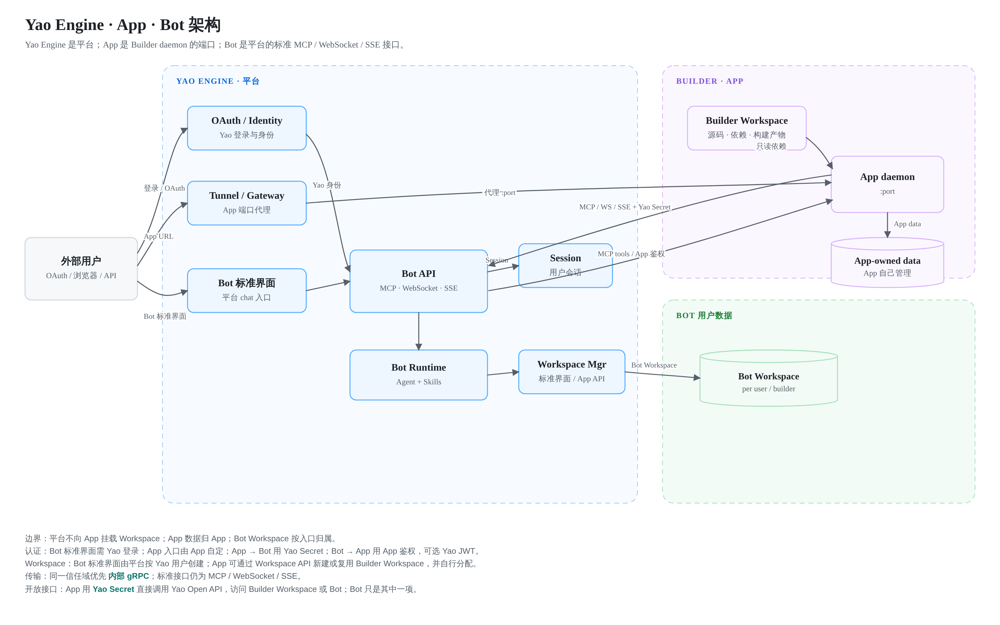

# Service

> 状态：草案 · 2026-10-20

Service 不是 App 与 Bot 共用的运行容器，而是 App 与 Bot 的边界定义。

App 与 Bot 独立部署、独立管理数据，通过标准接口互相调用。

## 1. 解耦后的模型

```text
App
  port                 Builder 启动的 daemon 端口
  bots[]               可选，关联的 Bot
  data                 App 自己管理的数据
  auth                 App 自己决定的用户认证

Bot
  agent                Agent 定义
  interfaces           MCP、WebSocket、SSE
  workspace            平台承载，按入口归属
  ui                   平台提供的标准 Bot 界面
```

核心边界：

- App 只暴露端口，平台不向 App 挂载 Workspace；
- App 的数据、数据库、文件和用户隔离由 App 自己决定；
- Bot 由平台运行，Workspace 按入口归属；
- App 使用 Bot 通过 Yao Open API，Bot 使用 App 通过 MCP；
- 两者不共享 Workspace，不共享内部数据目录。

App 与 Bot 的耦合只剩 Manifest、标准协议与身份。运行时与用户数据互不影响。

### 1.1 架构图



三条边界：

1. **Yao Engine → App**：只提供 Tunnel，不挂载 Workspace，不管理 App 数据。
2. **App → Bot**：通过 Yao Open API 调用，请求携带 Yao Secret，可选指定 App 自己的 Workspace。
3. **Bot → App**：只通过 App 暴露的 MCP 工具，不读取 App 数据库或文件。

## 2. App

App 是一个 Builder 开发并启动的 daemon。

```text
App
  daemon
  port
  data
  optional bots
```

规则：

- App 运行在 Builder Workspace，使用 Builder 的依赖与构建产物；
- 平台只建立隧道，把 App 的端口暴露给外部；
- 平台不把外部用户 Workspace 挂载进 App；
- 平台不管理 App 的用户数据与数据库；
- App 端口代理不强制 Yao 账号登录，是否要求登录由 App 自己决定；
- App 可以选择在 Bot 调用 App 时接受 Yao JWT，平台不向 App 注入终端用户身份；
- App 自己决定如何识别用户、保存数据、做权限与隔离；
- App 可以暴露 MCP 工具，供 Bot 调用；
- App 可以调用 Bot 的标准接口，完成需要 Agent 的工作。

App 的数据隔离由 App 负责。平台只负责隧道、App Manifest、身份能力与访问审计，不对 App 内部数据库或文件做隔离保证。

### 2.1 App Manifest

App 发布时提交一份 Manifest JSON，平台只读取这份声明，不读取 App 内部实现。

```json
{
  "id": "example-app",
  "name": "Example App",
  "version": "1.0.0",
  "homepage": "https://some.apps.yaoagents.com",
  "ports": [
    { "name": "web", "port": 8080, "protocol": "http", "public": true }
  ],
  "routes": [
    { "domain": "some.apps.yaoagents.com", "port": "web" }
  ],
  "auth": {
    "mode": "app",
    "acceptYaoJWT": false
  },
  "bots": [
    { "bot_id": "contract-reviewer" }
  ],
  "skills": [
    { "id": "contract-check", "version": "1.0.0", "protocol": "mcp", "endpoint": "/mcp" }
  ],
  "visibility": "public"
}
```

Manifest 的职责：

- 声明 App 的端口、协议与健康检查；
- 声明平台代理的域名与路由；
- 声明 App 可以调用的 Bot；
- 声明对外提供的 Skill，供外部平台调用；
- 声明 App 的鉴权方式，以及是否接受 Yao JWT；
- 声明可见范围：`public`、`unlisted` 或 `internal`。

Manifest 不包含用户数据、数据库连接串或密钥值。

### 2.2 Apps 列表

Apps 列表可以挂载三类 App：

| 类型 | 示例 | 说明 |
| --- | --- | --- |
| 官方外部 App | `some.apps.yaoagents.com` | Yao 官方提供，平台可代理 |
| 第三方外部 App | `some.apps.thirdpart.com` | 第三方自建，平台只登记与链接 |
| Builder 内部 App | 内网地址 | 不发布，只供内部访问 |

Apps 列表展示的是入口与 Manifest，不要求 App 运行在 Yao 上。外部 App 可以使用自己的域名、鉴权与计费；需要平台代理时才绑定 Tunnel。

### 2.3 计费

Bot 由 Yao 运行，App 调用 Bot 会产生平台费用。

- Yao 按 Yao Secret 计量，与 App 结算；
- Secret 标识 Builder 用户，账单归属该用户；
- App 自己决定对终端用户的收费方式，可以免费、订阅、按次或打包；
- Yao 不参与 App 与终端用户之间的计费；
- App 对终端用户免费，不等于 Bot 调用免费，App 仍需与 Yao 结算；
- App 不使用 Bot，不产生这项费用。

## 3. Bot

Bot 是平台运行的 Agent 服务。

```text
Bot
  agent
  skills
  workspace
  interfaces
  ui
```

Bot 对外提供三类标准接口：

| 接口 | 用途 |
| --- | --- |
| MCP | 工具与能力调用 |
| WebSocket | 双向会话与实时事件 |
| SSE | 单向流式响应 |

平台提供标准的 Bot 外访界面。外部用户通过标准界面访问 Bot 时，平台完成 Yao 身份校验、Session 创建与 Workspace 创建。

Bot 的 Workspace 由平台承载，但归属按入口区分：

- Bot 标准界面：平台按 Yao 用户创建 Workspace，同一用户再次访问时复用，不同用户之间隔离；
- App API：Workspace 属于 Builder 用户；App 可以通过 Workspace API 新建，也可以复用已有 Workspace；同一个 Workspace 可以服务一个或多个 App；
- Bot 调用的文件、Skill 与会话状态都保存在对应 Workspace 中；
- 管理员可以通过平台管理视图查看。

## 4. App 与 Bot 的调用

### Yao Open API

App 使用 Yao Secret 调用平台开放接口。Secret 本身就是凭据，不需要先换取 OAuth Token。

```text
App → Yao Open API
  ├─ Workspace API   读写 App 自己的 Workspace
  ├─ Bot API         调用 MCP / WebSocket / SSE
  └─ 其他开放接口
```

- Yao Secret 绑定 App 身份；
- App 只能访问自己身份下的数据；
- 请求直接携带 Secret；
- 调用发生在内部网络，不经过公网；
- Bot 只是开放接口中的一类，不是 App 的唯一依赖。

### App 调用 Bot

App 通过 Yao Open API 调用 Bot：

```text
App → Yao Open API → Bot
```

- App 请求携带 Yao Secret；
- Yao Secret 代表 Builder 用户，Workspace 属于这个 Builder 用户；
- App 可以通过 Workspace API 新建 Workspace，也可以复用已有 Workspace；
- 没有 App 专属 Workspace，新建出来的仍然是 Builder 用户的 Workspace；
- 同一个 Workspace 可以放一个 App，也可以放多个 App；
- App 通过 Workspace API 读写这个 Workspace；
- App 决定 Workspace 分配给哪个用户，或同时分配给哪些用户；
- App 调用 Bot 时传入 Workspace ID，平台校验该 Workspace 属于当前 Yao Secret 对应的 Builder 用户；
- App 不需要传递终端用户的 OAuth Token；
- Bot 必须在 App Manifest 中声明为可调用；
- 同一信任域内优先走内部 gRPC，标准接口作为回退。

### Bot 调用 App

Bot 通过 App 暴露的 MCP 工具调用 App：

```text
Bot → MCP → App
```

- App 决定暴露哪些工具；
- App 决定工具需要什么用户身份与权限；
- App 可以使用自己的鉴权；
- App 可以拒绝或接受 Yao 签发的 JWT；
- Bot 只拿到工具结果，不读取 App 内部数据库或文件；
- App 不因为被 Bot 调用而获得 Bot 的 Workspace。

### Bot 作为 App 的 Agent 包装

当 App 把能力暴露为 MCP 时，Bot 可以作为这组 MCP 工具的 Agent 包装。

```text
Bot
  └─ MCP tools
       └─ App
```

Bot 负责对话、规划与工具编排，App 负责实际业务执行与数据。两者仍通过标准 MCP 接口连接，不共享运行时。

### 内部 gRPC

App 与 Bot 在同一部署或同一信任边界内时，可以走内部 gRPC 通道。

- gRPC 是传输方式，不改变数据归属与权限边界；
- 不经过公网 Tunnel，减少一跳，降低延迟；
- 仍需要服务间身份校验，使用 Yao Secret；不附带终端用户 OAuth Token；
- 不能因为走内部通道就跳过 Workspace 与租户校验；
- 外部用户仍然通过平台的 Tunnel 或 Bot 标准界面进入；
- 内部 gRPC 不可用时，可以回退到标准 MCP、WebSocket 或 SSE。

## 5. 身份与 Workspace

| 访问路径 | 身份 | 认证方式 | Workspace |
| --- | --- | --- | --- |
| App URL | 用户或匿名 | App 自己决定，平台不强制 Yao 登录 | App 自己管理 |
| Bot 标准界面 | Yao 用户 | Yao 账号登录 | 平台按用户创建 |
| App → Yao Open API | Builder 用户 | Yao Secret | Builder Workspace |
| Bot → App | App | App 自己的鉴权，可选接受 Yao JWT | App 自己管理 |

### Bot 标准界面

外部用户访问 Bot 标准界面时：

1. 平台校验 Yao 账号；
2. 平台创建或复用该用户的 Workspace；
3. 平台创建 Session；
4. Bot 在用户 Workspace 中运行。

这与登录平台后通过 Bot 访问的流程一致。

### Bot API

外部系统通过 API 访问 Bot 时：

- App 调用使用 Yao Secret，请求直接携带；
- Yao Secret 代表 Builder 用户；
- Workspace 属于 Builder 用户，不是 App 专属 Workspace；
- App 通过 Workspace API 读写这个 Workspace；
- App 传入 Workspace ID，平台校验该 Workspace 属于当前 Builder 用户；
- App 自己决定 Workspace 分配给哪个用户，或同时分配给哪些用户；
- App 不需要传递终端用户的 OAuth Token。

App 与终端用户之间的身份映射和工作区分配由 App 自己处理。

### App

App 的用户体系、Workspace 分配与终端用户身份由 App 自己处理，Yao 不参与。

App 可以：

- 使用自己的登录体系识别用户；
- 在选择接受时校验 Yao 签发的 JWT，用于 Bot 调用 App 的场景；
- 用自己的数据库保存用户数据；
- 用自己的文件系统或对象存储保存文件；
- 在自己的数据上实现隔离。

平台不把 Builder Workspace 当作 App 的用户数据区。

## 6. 数据归属

| 数据 | 归属 | 隔离责任 |
| --- | --- | --- |
| App 数据库、App 文件、App 用户数据 | App | App 自己 |
| Bot API 使用的 Builder Workspace | Builder 用户 | Builder 用户；App 只负责选择 |
| Bot 标准界面创建的 Workspace | 平台 | 平台按 Yao 用户隔离 |
| Bot Session | 平台 | 平台 |
| Bot 调用的 App MCP 结果 | App | App |
| Yao JWT | 平台签发 | 平台校验，调用方不得转交无关方 |

App 与 Bot 之间不共享数据目录。需要交换数据时，通过 MCP 工具或标准 API 显式传递。

## 7. 隧道

平台为 App 建立到 daemon 端口的隧道。

- 只暴露端口，不暴露 Builder Workspace；
- 入口不强制 Yao 账号登录，是否要求认证由 App 决定；
- 平台只做 TLS、限流、转发与访问记录；
- 支持 HTTP、WebSocket 与 SSE；
- 记录访问者、App、状态码与耗时；
- 不向 App 注入用户 Workspace；
- App 的数据库与文件访问由 App 自己处理。

## 8. 边界检查

- App 是否依赖平台 Workspace 才能运行；
- App 是否把 Builder 凭据当作外部用户身份；
- Bot 是否直接读取 App 数据库或文件；
- App 是否直接读取 Bot Workspace；
- API 指定的 Workspace 是否属于当前 Builder 用户；
- App 是否自行决定了 Workspace 的用户分配与审计；
- Bot 标准界面与 API 是否区分了 Yao 用户 Workspace 与 Builder Workspace；
- Yao JWT 是否只用于 Bot 调用 App，而没有混入 App 调用 Bot。

Yao Secret 的轮换与吊销使用 Yao OpenAPI 的标准接口。
